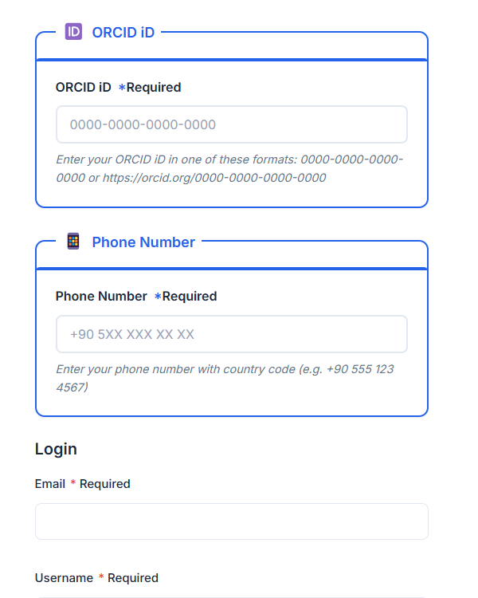
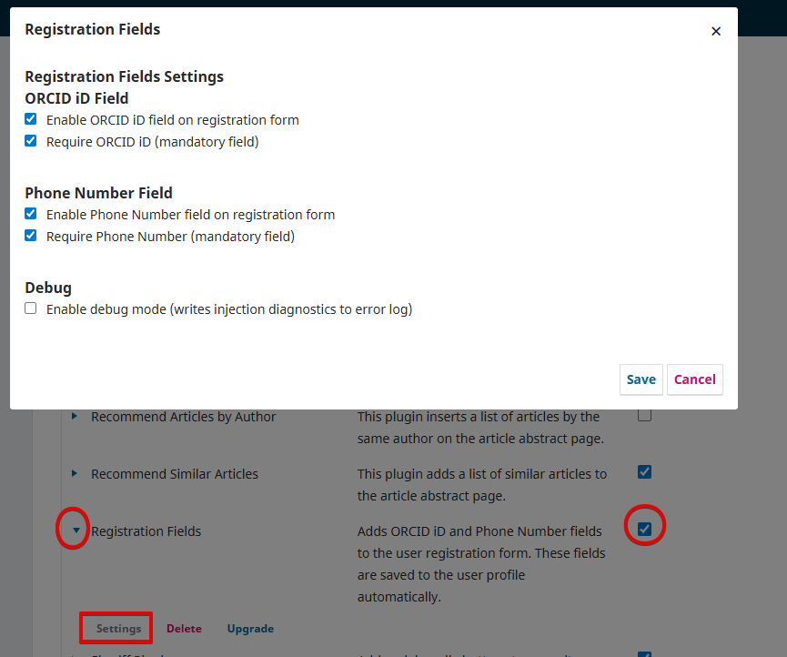

# Registration Fields Plugin for OJS 3.3

Adds **ORCID iD** and **Phone Number** fields to the OJS user registration form. Values entered during registration are saved directly to the user profile — no core file modifications required.

## Why This Plugin?

OJS stores ORCID iD and phone number in user profiles, but these fields are only available *after* registration through the profile editor. This creates an extra step for both users and journal managers. The plugin solves this by bringing those fields into the registration form itself, so the data is captured from the start.

## Features

- **ORCID iD field** on the registration form with format validation
- **Phone number field** on the registration form with format validation
- Each field can be independently **enabled or disabled**
- Each field can be set as **required or optional**
- **Server-side validation** for both fields
- Accepted ORCID formats: `0000-0000-0000-0000`, `https://orcid.org/…`, `http://orcid.org/…` — all normalised to HTTPS on save
- Values are written to the existing OJS user profile (Profile > Public > ORCID iD / Profile > Contact > Phone)
- Works across OJS themes (Default, Manuscript, Bootstrap3, Health Sciences)
- Bilingual interface: English and Turkish
- No core file modifications — pure hook-based architecture

  Registration form with ORCID iD and Phone Number fields


Plugin settings panel

## Requirements

| Requirement | Version |
|---|---|
| OJS | 3.3.0.0 – 3.3.0.22 |
| PHP | 7.4 – 8.2 |

## Installation

1. Download the latest `.tar.gz` from [Releases](https://github.com/ojs-services/registrationFields/releases).
2. In OJS, go to **Settings → Website → Plugins → Upload a New Plugin**.
3. Upload the `.tar.gz` file.
4. Enable the plugin in the **Generic Plugins** list.
5. Click **Settings** next to the plugin name to configure fields.

### Manual Installation

1. Extract the archive into `plugins/generic/registrationFields/`.
2. Clear the template cache: delete all files inside `cache/t_compile/`.
3. Enable the plugin from the plugin management page.

## Configuration

After enabling the plugin, click **Settings** to access the configuration modal:

| Setting | Description |
|---|---|
| Enable ORCID iD field | Show the ORCID iD field on the registration form |
| Require ORCID iD | Make ORCID iD mandatory for registration |
| Enable Phone Number field | Show the phone number field on the registration form |
| Require Phone Number | Make phone number mandatory for registration |
| Debug mode | Write injection diagnostics to the PHP error log |

The "Require" option is automatically disabled when the corresponding field is not enabled.

## Theme Compatibility

The plugin uses flexible regex patterns with word boundaries to locate injection points in the registration form HTML. This ensures compatibility with themes that add inline styles, multiple CSS classes, or extra attributes to form elements.

If the plugin cannot find a known landmark (`login` fieldset, `consent` fieldset, or `buttons` div), it falls back to inserting fields before the closing `</form>` tag. This guarantees the fields are always visible regardless of the theme in use.

When debug mode is enabled, the plugin writes diagnostic messages to the PHP error log indicating which injection point was used or whether the fallback was triggered. This is useful for troubleshooting theme-specific issues.

## How It Works

The plugin uses OJS's hook system to integrate with the registration workflow:

1. **Field injection** — An output filter inserts HTML fields into the rendered registration form, positioned between the profile and login sections.
2. **Data capture** — The `registrationform::readuserdata` hook reads the submitted values.
3. **Validation** — The `registrationform::validate` hook performs server-side validation with pattern matching.
4. **Persistence** — The `registrationform::execute` hook captures field values and saves them via a deferred callback after the user record is created.

## Field Validation

### ORCID iD
- Accepts three formats: bare (`0000-0000-0000-0000`), HTTPS URL, or HTTP URL
- Pattern: `XXXX-XXXX-XXXX-XXXY` where X is a digit and Y is a digit or `X`
- Automatically normalised to `https://orcid.org/…` on save
- Maximum 37 characters

### Phone Number
- Allows digits, spaces, `+`, `-`, `(`, `)`, `.`
- Length: 5–24 characters
- Maximum 24 characters

## Security

- All user input is escaped with `htmlspecialchars()` before rendering in HTML
- Server-side validation with strict regex patterns for both fields
- CSRF protection via OJS's built-in `{csrf}` token in the settings form
- Plugin settings are only accessible to users with the Journal Manager role
- No raw SQL queries — all database operations go through OJS's DAO layer
- Input length limits enforced both client-side (`maxlength`) and server-side

## File Structure

```
registrationFields/
├── RegistrationFieldsPlugin.inc.php   Main plugin class
├── index.php                          Plugin loader
├── version.xml                        Version and compatibility
├── LICENSE                            GPL v3
├── README.md                          English documentation
├── README_TR.md                       Turkish documentation
├── templates/
│   └── settingsForm.tpl               Settings modal template
└── locale/
    ├── en_US/locale.po                English translations
    └── tr_TR/locale.po                Turkish translations
```

## License

This plugin is licensed under the [GNU General Public License v3](https://www.gnu.org/licenses/gpl-3.0.en.html).

## Author

Developed by [OJS Services](https://ojs-services.com).
